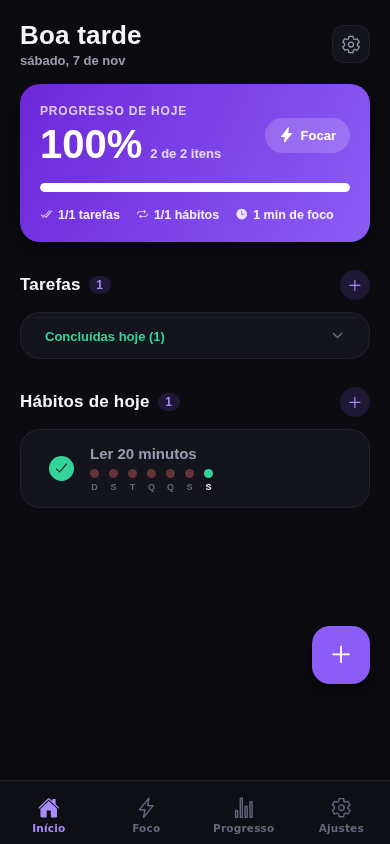
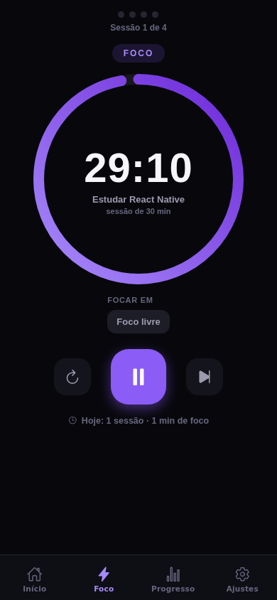
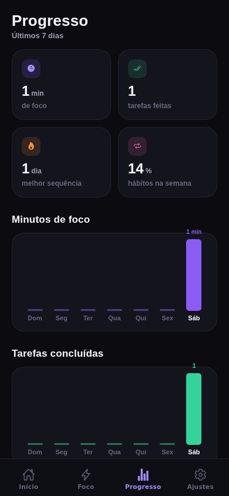
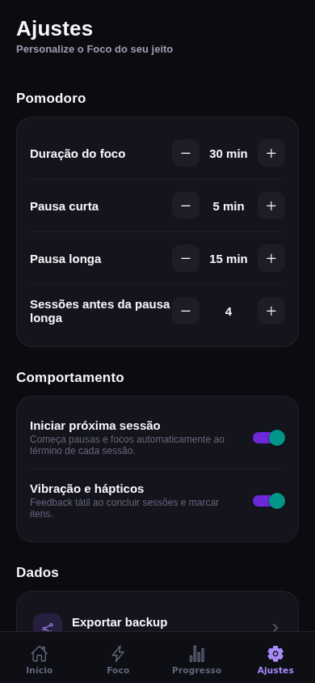

# Foco — Tarefas, Hábitos & Pomodoro

App mobile de produtividade feito com **React Native + Expo (SDK 58) + TypeScript**, todo em português (pt-BR), com tema dark e acento violeta.

| Home | Foco (Pomodoro) | Progresso | Ajustes |
| --- | --- | --- | --- |
|  |  |  |  |

## O que ele faz

**Task Manager**
- Tarefas com título, notas, categoria (Trabalho, Estudo, Saúde, Casa, Pessoal), prioridade (baixa/média/alta) e prazo
- Prazos relativos ("Hoje", "Amanhã", "Em 7 dias") ou data exata via seletor nativo
- Atrasadas destacadas em vermelho; concluídas do dia agrupadas em seção recolhível
- Tempo total de foco e nº de pomodoros acumulados por tarefa

**Habit Tracker**
- Hábitos com frequência por dia da semana (ou atalhos "Todos os dias" / "Dias de semana")
- Marcação diária com um toque, mini-histórico dos últimos 7 dias em cada linha
- Sequências (streaks) atuais e recordes com visualização por semana

**Pomodoro**
- Timer circular com gradiente, baseado em relógio de parede: **continua contando com o app em segundo plano e sobrevive a reinícios**
- Notificação Android com contagem regressiva em tempo real e aviso ao concluir cada foco ou pausa
- Sessões vinculadas a tarefas — o tempo focado é somado à tarefa selecionada (ou "Foco livre")
- Ciclos com pausa curta e pausa longa configuráveis (foco 15–60 min, pausa 3–15 min, pausa longa 10–30 min, 2–6 ciclos)
- Início automático da próxima sessão, pulo de sessão (com crédito parcial do tempo focado), tela que não dorme durante o foco e feedback háptico

**Estatísticas**
- Cartões-resumo: minutos de foco, tarefas concluídas, melhor sequência e taxa de hábitos
- Gráficos de barras dos últimos 7 dias (foco em minutos, tarefas, % de hábitos) com o dia de hoje em destaque
- Ranking de sequências por hábito (atual e recorde)

**Dados**
- Tudo salvo localmente no aparelho (AsyncStorage) — funciona 100% offline
- **Backup**: exportar todos os dados num arquivo JSON (painel de compartilhamento) e importar de volta com validação

## Como rodar

Pré-requisito: [Node.js 18+](https://nodejs.org) e o app **Expo Go** no celular ([Android](https://play.google.com/store/apps/details?id=host.exp.exponent) / [iOS](https://apps.apple.com/app/expo-go/id982107779)).

```bash
npm install
npx expo start
```

Escaneie o QR Code com o Expo Go (Android) ou a câmera (iOS). Também funciona no emulador Android / simulador iOS com `npx expo start --android` / `--ios`, e no navegador com `--web`.

As notificações do Pomodoro usam um serviço Android nativo, incluído pelo plugin `plugins/withFocoTimer.js`. Para usar esse recurso no celular, gere e instale uma nova versão do app:

```bash
npx expo prebuild --platform android
npm run android
```

O código nativo fica em `native/android` e é copiado pelo plugin durante o prebuild. O Expo Go permite usar o timer, mas não inclui esse serviço. No Android 13 ou superior, a permissão de notificações é solicitada ao tocar em **Iniciar**. Se ela for negada, o timer continua funcionando e a tela explica como habilitar os avisos.

A contagem na notificação é renderizada pelo próprio Android. O serviço mantém o prazo com a tela bloqueada, emite o aviso final e respeita a configuração de iniciar a próxima sessão automaticamente. Pausar ou reiniciar remove a notificação em andamento. Forçar a parada do app nos ajustes do Android encerra o serviço.

## Estrutura do projeto

```
src/
├── app/                 # Telas (expo-router)
│   ├── _layout.tsx      # Tabs: Início · Foco · Progresso · Ajustes
│   ├── index.tsx        # Home: progresso do dia + tarefas + hábitos
│   ├── foco.tsx         # Pomodoro em tela cheia
│   ├── stats.tsx        # Estatísticas semanais
│   └── ajustes.tsx      # Configurações + backup
├── components/          # TaskRow, HabitRow, modais, gráficos, anel SVG, primitivas de UI
├── context/app.tsx      # Estado global + persistência + máquina de estados do timer
├── constants/           # Tema (cores/espaçamentos) e categorias
└── lib/                 # Tipos, datas, estatísticas, backup
```

**Decisões de arquitetura**

- O timer é uma máquina de estados persistida: enquanto roda, o estado guarda `endsAt` (epoch ms). O restante é derivado do relógio, então o app pode ser fechado/reaberto sem perder a sessão. Sessões vencidas são reconciliadas na inicialização e ao retornar ao app. As transições ficam em `src/lib/timer.ts`; o serviço Android acompanha as mesmas fases enquanto o JavaScript está suspenso.
- Um único contexto (`AppProvider`) centraliza dados e ações — sem biblioteca de estado externa.
- Gráficos e o anel do Pomodoro são feitos com Views/SVG puros (sem dependências de gráfico).
- Projeto lintado e tipado: `npm run typecheck` e `npm run lint` passam limpos (regras compatíveis com React Compiler).

## Scripts

| Comando | O que faz |
| --- | --- |
| `npm start` | Inicia o dev server (Expo) |
| `npm run android` / `npm run ios` | Abre no emulador/simulador |
| `npm run web` | Abre no navegador |
| `npm run lint` | ESLint |
| `npm run typecheck` | TypeScript |
| `npm test` | Testes do timer, permissões de notificação e plugin Android |

## Próximos passos (sugestões)

- Widget de tarefas do dia e complicação de streak
- Repetições de tarefas (diária/semanal) e subtarefas
- Tema claro com alternância automática

---

Feito com Expo SDK 58 · React Native 0.88 · TypeScript. Ícone e identidade gerados para o projeto.
